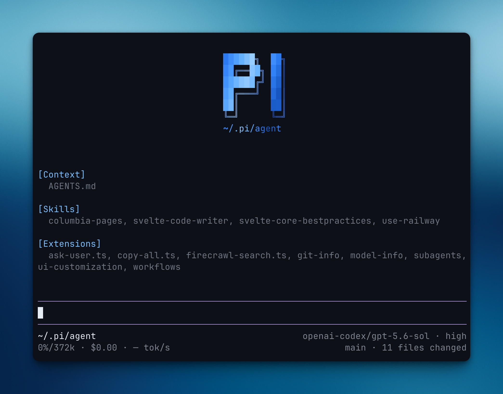

# My Pi setup

My reusable configuration for the [Pi coding agent](https://github.com/badlogic/pi-mono).

It includes:

- custom tools for web search, file search, planning, and user prompts
- background terminals, subagents, and multi-agent workflows
- Git, model, and status-line UI customizations
- reusable skills and a GitHub-inspired dark theme

See [SETUP.md](SETUP.md) for installation instructions.

## Credits

This setup is based on [davis7dotsh/my-pi-setup](https://github.com/davis7dotsh/my-pi-setup). I copied and adapted extensions from that repository for my own workflow. Thanks to [Davis Haupt](https://github.com/davis7dotsh) for sharing the original setup and extension work.

Individual skills and integrations can come from their linked upstream projects. See their files for project-specific details.
